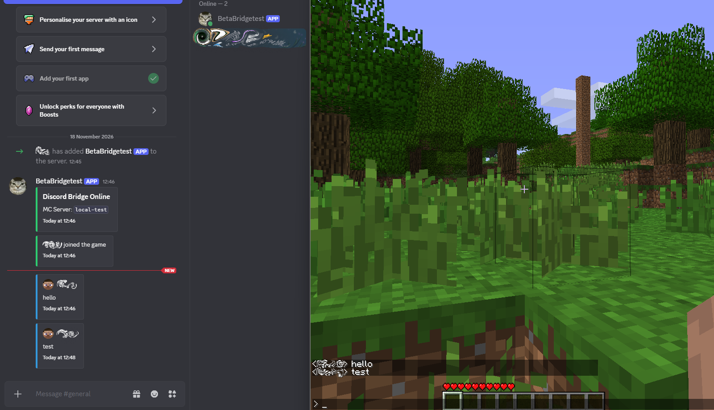

# Minecraft Beta 1.7.3 Discord Bridge

A lightweight Discord ↔ Minecraft chat bridge for **Beta 1.7.3** servers.

**No plugins, no mods, no Bukkit required.** It works with the vanilla server jar by reading `server.log` and sending messages to the console through GNU screen, so it won't touch your server files and works with pretty much any Beta 1.7.3 setup.



## Features

- **MC → Discord**: chat messages, player join/leave events
- **Discord → MC**: Discord messages shown in-game (via the `say` command)
- **Embeds** with player heads (via [minotar.net](https://minotar.net))
- **Safe input handling**: Discord messages are sanitized before they reach the console, and long messages are split so they don't kick Beta clients
- Tiny codebase (~250 lines of Python), easy to read and modify

## Requirements

- Linux (or anything with GNU `screen`)
- Python 3.8+ (Python 3.6 works with `discord.py` 1.7.3)
- Minecraft Beta 1.7.3 server running inside a `screen` session
- A Discord bot token

## Installation

### 1. Clone and install dependencies

```bash
git clone https://github.com/OldBeardMan/minecraft-beta-1.7.3-discord-bridge.git
cd minecraft-beta-1.7.3-discord-bridge
pip3 install --user -r requirements.txt
```

### 2. Create a Discord bot

1. Go to https://discord.com/developers/applications
2. Create an application and add a bot
3. Copy the bot **token**
4. In the **Bot** tab, enable **MESSAGE CONTENT INTENT**
5. Invite the bot to your server with these permissions: Send Messages, Embed Links, Read Message History

### 3. Configure

```bash
cp .env.example .env
```

Edit `.env`:

```env
DISCORD_TOKEN=your_token_here
DISCORD_CHANNEL_ID=channel_id_here
SERVER_LOG_PATH=../server/server.log   # relative to bot.py, or an absolute path
SCREEN_SESSION_NAME=minecraft
MC_PREFIX=[Minecraft]
DISCORD_PREFIX=[Discord]
```

**Finding the channel ID:** enable Developer Mode in Discord (Settings → Advanced), then right-click the channel → Copy Channel ID.

**Finding the screen session name:**

```bash
screen -ls
# e.g. "12345.minecraft"  ->  use "minecraft"
```

## Usage

The Minecraft server must already be running in a screen session. Then start the bot in its own session:

```bash
screen -S discord-bot
python3 bot.py
# Detach with Ctrl+A, D
```

## Commands

- `!status`: shows bot status, the screen session and whether the log file was found

## How it works

**MC → Discord**
- Polls `server.log` once per second for new lines
- Matches chat, join and leave lines with regex
- Posts them to the Discord channel as embeds

**Discord → MC**
- Listens for messages in the configured channel
- Strips characters that screen or Minecraft would interpret (control characters, `^`, `\`, `$`, `§`)
- Sends `say [Discord] Username: message` with `screen -X stuff`

## Troubleshooting

**The bot doesn't pick up Minecraft messages**
- Check that `SERVER_LOG_PATH` points to the right file
- Make sure the user running the bot can read it

**Discord messages don't show up in-game**
- Check the session name with `screen -ls`
- Make sure the bot runs as the **same Linux user** as the server's screen session
- Make sure `screen` is installed

**Installing packages on old systems (e.g. CentOS 7 / Python 3.6)**
```bash
sudo yum install python3-devel gcc -y
pip3 install --user -r requirements.txt
```

## Project structure

```
├── bot.py                  # Main bot
├── screen_integration.py   # GNU screen integration + input sanitizing
├── requirements.txt        # Python dependencies
├── .env.example            # Configuration template
└── README.md
```

## Contributing

Issues and pull requests are welcome! If your server uses a different log format (e.g. a modded or Bukkit server), open an issue and include a few sample log lines.

## License

[MIT](LICENSE)
